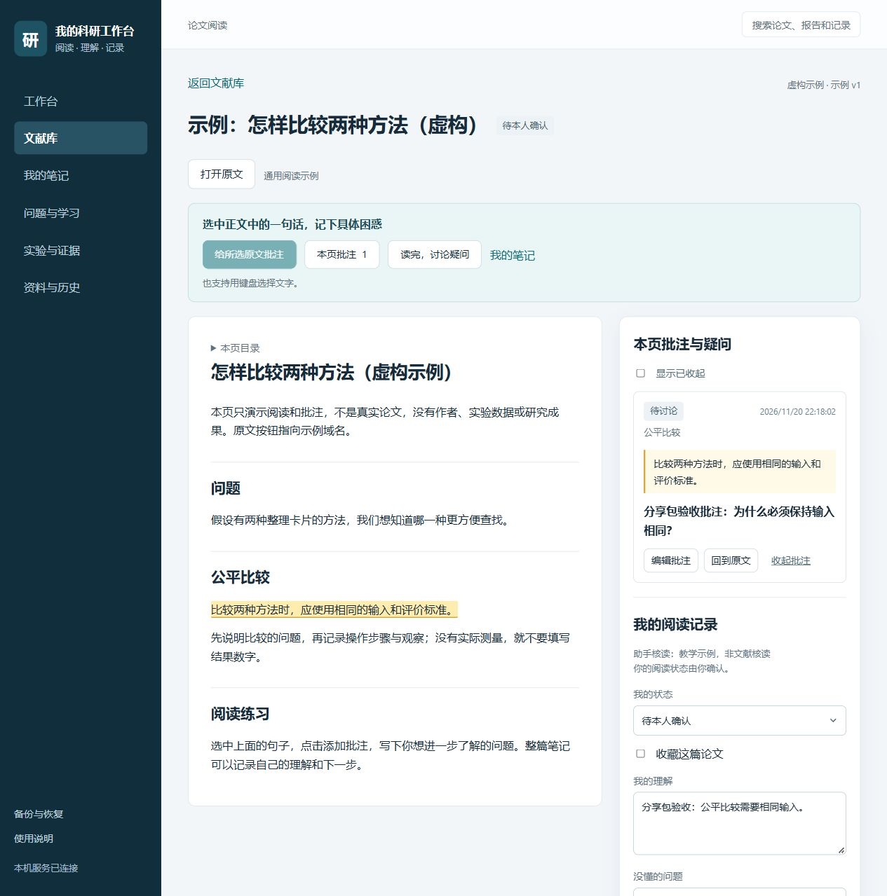

# Research Workbench · 科研工作台

在本机阅读资料、选中原文写批注、整理疑问，并留下下一次能继续的理解。

**阅读 → 批注 → 整理讨论材料 → 手动与 AI 讨论 → 回填自己的理解。**

[下载 Windows 测试版](https://github.com/Eating-King-Git/research-workbench/releases) · [使用指南](docs/USER_GUIDE.md) · [开发与构建](docs/DEVELOPMENT.md) · [反馈问题](https://github.com/Eating-King-Git/research-workbench/issues)



截图内容是虚构教学示例和功能测试记录，不是真实论文或研究结果。

## 能做什么

- 文献列表筛选、收藏、阅读状态和本地 Markdown 正文搜索。
- 在工作台正文中选中句段，保存问题、讨论摘录和自己的理解。
- 从“我的笔记”回到原文；原文变动时提示核对引用。
- 汇总已保存的问题，生成可复制或下载的讨论材料。不会自动发送给 AI。
- 记录当前任务；导出和恢复个人记录，保存修订历史并检查编辑冲突。

数据保存在本机文件夹中，无需工作台账号、数据库服务或模型 API 密钥。

## 三步开始

目前发布目标是 **Windows x64 + 标准 CPython 3.13 x64**。请自行安装 [Python](https://www.python.org/downloads/windows/)，安装时启用 Python Launcher 或将 `python` 加入 PATH；不支持自由线程 `3.13t` 构建。

1. 在 [Releases](https://github.com/Eating-King-Git/research-workbench/releases) 下载 `ResearchWorkbench-…-windows-x64.zip`，完整解压到可写目录。GitHub 自动生成的 `Source code` ZIP 不含离线依赖。
2. 双击 **首次安装.cmd**，等待安装完成。发布包附带锁定的离线依赖，不需要访问 PyPI。
3. 双击 **启动工作台.cmd**，打开 <http://127.0.0.1:8767/app/>。用完运行 **停止工作台.cmd**；关闭网页不会停止服务。

先打开“怎样比较两种方法（虚构示例）”，选中一句话写批注，再试着保存整篇笔记。

## 数据放在哪里

| 目录 | 内容 |
| --- | --- |
| `program/` | Python 服务与网页界面 |
| `examples/site/` | 仓库自带的干净教学模板 |
| `site/` | 首次安装创建的本机资料副本，Git 忽略 |
| `site/07_个人记录/` | 笔记、批注、收藏、任务、修订与导入前备份 |
| `.venv/` | 本机独立 Python 环境，Git 忽略 |
| `wheels/` | 下载包附带的离线依赖，不提交 Git |

重新安装不会把示例覆盖到已有 `site/`。网页 JSON 备份只包含个人记录，不包含 Markdown、PDF 或基础文献元数据。完整迁移请停止服务后复制整个目录，在新位置重新运行首次安装。详见 [备份与迁移](docs/USER_GUIDE.md#备份与迁移)。

## 当前边界

- 首个公开测试版；已在一台 Windows 电脑的独立解压环境验证，尚未在第二台物理电脑验收。
- 批注用于工作台内渲染的 Markdown，暂不支持外部网页和独立 PDF。
- 网页“收录论文”保存网址与信息，不会自动下载论文或生成阅读卡。
- 只有本机服务，没有账号体系、多人协作、云同步或嵌入式模型调用。
- AI 讨论由用户手动发起；讨论材料可能包含自己的笔记和本机路径，发送前应检查。

## 从源码运行

Windows / Python 3.13 x64，在仓库根目录执行：

```powershell
python tools/fetch_wheels.py
python runtime.py install
python runtime.py start
```

第一条命令从官方 PyPI 获取锁定文件并校验 SHA256；之后安装离线进行。开发、测试和打包步骤见 [DEVELOPMENT.md](docs/DEVELOPMENT.md)。

## 参与与许可

欢迎通过 Issue 反馈可复现问题，或提交小范围修复，参见 [贡献说明](CONTRIBUTING.md)。请使用虚构数据复现，不上传自己的笔记、备份或密钥。

项目自有代码与文档使用 [MIT License](LICENSE)。第三方依赖继续遵守各自许可，见 [第三方声明](THIRD_PARTY_NOTICES.md)。项目使用 AI 辅助开发；功能描述以实际实现与测试记录为准。
